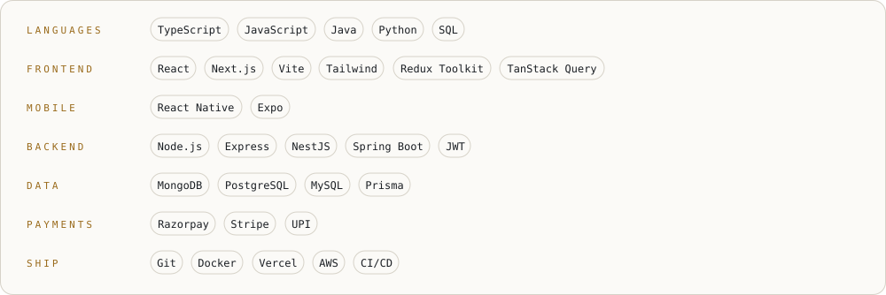

<picture>
  <source media="(prefers-color-scheme: dark)" srcset="banner_dark.svg">
  
</picture>

## Now

- Building multi-tenant ERP for playgroups and schools: attendance, fees with UPI, notices, report cards, pickup approval. Hindi and English.
- Designing a billing and POS app for restaurants.
- Studying system design and AWS.

## Selected work

| Project | What it is | Stack | Links |
|---|---|---|---|
| **Playgroup ERP and School ERP** | Multi-tenant ERP: attendance, fees, notices, report cards, role-based apps on web and mobile | Node, Express, TypeScript, MongoDB, Expo | Private, demo on request |
| **AuraSchool OS** | School platform: web portal, shared API, mobile app, row-level tenant security | Next.js 15, NestJS, Prisma, Expo, Turborepo | Private |
| **Ceased** | E-commerce: cart, checkout, Razorpay, SMS auth, admin panel | React, Node, MongoDB, Razorpay | Private |
| **QuickShow** | Movie booking with seat selection and payments | React, Node, MongoDB, Clerk, Stripe, Inngest | [Live](https://quickshow-sigma.vercel.app/) · [Code](https://github.com/Reallyishan009/QuickShow) |
| **PingUp** | Social platform: profiles, posts, messaging | React, Redux Toolkit, Node, MongoDB, Clerk, ImageKit | [Live](https://pingup-frontend-five.vercel.app) · [Code](https://github.com/Reallyishan009/PingUp-SocialMediaApp) |
| **Book Finder** | Academic book search with autocomplete and recommendations | React, Vite, Node, Open Library API | [Live](https://book-finder-omega-ten.vercel.app/) · [Code](https://github.com/Reallyishan009/Book-Finder) |
| **Neighbourhood Share** | Lend and borrow items in a community | React, Vite, Tailwind, Express | [Live](https://neighbourhood-frontend-theta.vercel.app) · [Code](https://github.com/Reallyishan009/Neighbourhood-share) |
| **Store Rating Platform** | Role-based ratings, tested REST API | React, Express, MySQL, Sequelize, Jest | [Code](https://github.com/Reallyishan009/Store-Rating-Platform-App) |

## Toolkit

<picture>
  <source media="(prefers-color-scheme: dark)" srcset="toolkit_dark.svg">
  
</picture>

## Beyond code

Four years of UPSC preparation, a master's in public administration, guitar, the gym, and a [YouTube channel](https://www.youtube.com/@Reallyishan).

Problem solving: [LeetCode](https://leetcode.com/IshanTripathi09) · [Codeforces](https://codeforces.com/profile/Reallyishan009) · [HackerRank](https://www.hackerrank.com/ishantripathidoc) · [GeeksforGeeks](https://www.geeksforgeeks.org/user/reallyishan/)
